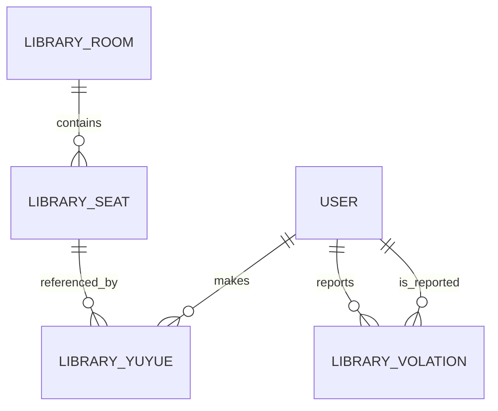

> **Documentation status:** This page describes the inspected backend source, not a verified production deployment. Implemented behavior and recommended changes are explicitly distinguished.

## Core entities

| Entity / table | Key fields | Meaning |
| --- | --- | --- |
| `LibraryRoom` / `library_room` | `id`, `name`, `address` | Library reading room |
| `LibrarySeat` / `library_seat` | `id`, `card`, `roomId`, `roomName`, `status` | Individual seat and room reference |
| `LibraryYuyue` / `library_yuyue` | `id`, `userId`, `userName`, `roomName`, `seatId`, `seatName`, `status`, `yyTime`, `startTime`, `endTime` | Reservation and attendance timestamps |
| `LibraryBook` / `library_book` | `id`, `name`, `price`, `author`, `press`, `pressTime` | Catalog entry |
| `LibraryVolation` / `library_volation` | `id`, `sendId`, `receiveId`, `status`, `num`, `remark`, `sendTime` | Violation/complaint and credit adjustment |
| `User` / system user model | `id`, `username`, `nickName`, `avatarPath`, `roles`, `num` | Authenticated user, profile image and credit value |

`LibrarySeat.roomId`, `LibraryYuyue.seatId`, and the violation sender/receiver IDs express logical relationships. The examined library entities use scalar IDs rather than explicit JPA `@ManyToOne` associations. Therefore, the relationship diagram below is a **logical model**, not a verified set of physical database foreign keys.

## Seat state

The `LibrarySeat.status` field is set to `1` when a seat is created, to `2` when a reservation is created, and back to `1` on successful face-verified check-out. The implementation therefore uses **1 = available** and **2 = occupied/reserved** in these paths. An exhaustive server-validated enum is not defined in the inspected entity.

## Reservation state

The `LibraryYuyue.status` entity comment defines:

| Value | Meaning | When set in the inspected controller |
| --- | --- | --- |
| `0` | Not checked in | Set on reservation creation |
| `1` | Checked in | Can be supplied as `status` to `/dao` |
| `2` | Temporarily away | Can be supplied to `/li` |
| `3` | Checked out | Can be supplied as `status` to `/tui` |

**Implementation caveat:** `/li`, `/dao`, and `/tui` accept a client-supplied `status`; the controller does not independently enforce each transition or all object-ownership conditions. The statuses above describe intended meaning, not an enforced finite-state machine.

## Inspect the implementation

- [Seat entity](https://github.com/lycoris9029/Library-Reservation-System/blob/main/library-system/src/main/java/com/javabs/modules/library/domain/LibrarySeat.java)
- [Reservation entity](https://github.com/lycoris9029/Library-Reservation-System/blob/main/library-system/src/main/java/com/javabs/modules/library/domain/LibraryYuyue.java)

## Related pages

[Seat and room feature docs](/engineering/data-model) · [Reservation workflow](/engineering/reservation-workflow)
