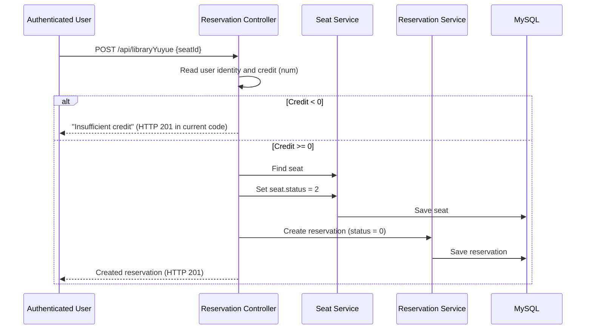

> **Documentation status:** This page describes the inspected backend source, not a verified production deployment. Implemented behavior and recommended changes are explicitly distinguished.

The server sets the reservation owner from the authenticated session, rather than trusting `userId` in the request body. It copies the seat and room display names from the selected seat. **No atomic seat claim, availability check, or encompassing transaction appears in the inspected controller**, leaving a risk of concurrent duplicate reservations or partial updates.

## Inspect the implementation

- [Reservation controller](https://github.com/lycoris9029/Library-Reservation-System/blob/main/library-system/src/main/java/com/javabs/modules/library/rest/LibraryYuyueController.java)
- [Seat service](https://github.com/lycoris9029/Library-Reservation-System/blob/main/library-system/src/main/java/com/javabs/modules/library/service/impl/LibrarySeatServiceImpl.java)

## Related pages

[Existing reservation feature docs](/engineering/reservation-workflow) · [Reservation API reference](/engineering/api-contract)
