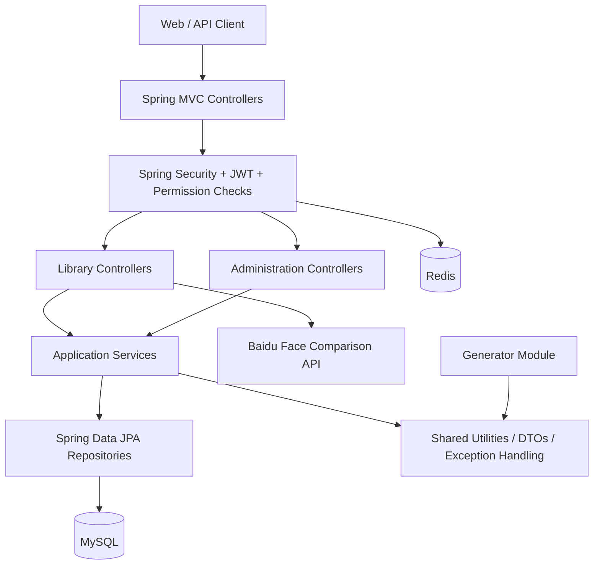

> **Documentation status:** This page describes the inspected backend source, not a verified production deployment. Implemented behavior and recommended changes are explicitly distinguished.

## Logical component view



The logical flow for most library operations is `Controller → Service → Repository → MySQL`, with DTO mapping by MapStruct and page formatting by `PageUtil`. Security is enforced through the request filter chain and (on annotated methods) expression-based permission checks.

## Maven module breakdown

```text
library/                         # root Maven aggregator (version 2.6)
├── pom.xml
├── library-common/              # infrastructure, base DTOs, utilities, exceptions
├── library-generator/           # code-generation endpoints and templates
└── library-system/              # runnable Spring Boot application
    └── src/main/java/com/javabs/
        ├── AppRun.java          # application entry point
        ├── modules/library/     # rooms, seats, reservations, books, violations
        ├── modules/security/    # authentication and JWT enforcement
        └── modules/system/      # users, roles and administration
```

## API request lifecycle

1. The client sends an HTTP request, ordinarily with `Authorization: Bearer <token>`.
2. Spring Security validates authentication, except for explicitly anonymous endpoints.
3. A controller's `@PreAuthorize` expression checks required permissions where specified.
4. Controller code handles contextual rules, then delegates to a service/repository.
5. JPA persists or retrieves entities; DTOs are returned to the caller.
6. Exceptions are processed by a shared `@RestControllerAdvice` handler.

## Inspect the implementation

- [Application entry point](https://github.com/lycoris9029/Library-Reservation-System/blob/main/library-system/src/main/java/com/javabs/AppRun.java)
- [Root Maven POM](https://github.com/lycoris9029/Library-Reservation-System/blob/main/pom.xml)

## Related pages

[Domain model](/engineering/data-model) · [Original architecture page](/engineering/system-architecture)
